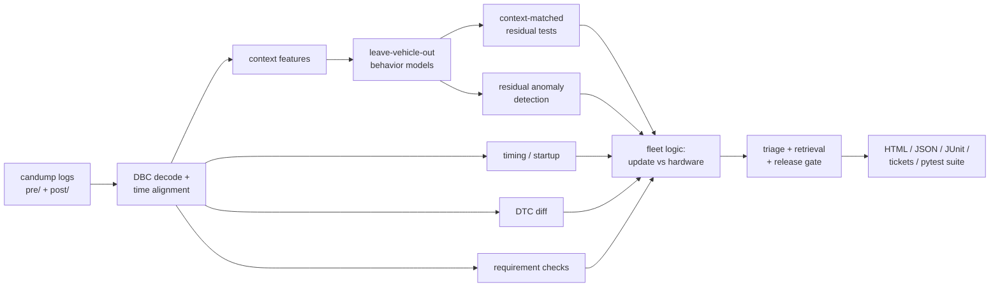

# otasentry

**Context-aware differential validation for over-the-air (OTA) vehicle software updates.**

otasentry compares how a fleet behaved before and after an OTA update, using raw CAN logs and a DBC
file. It tells you *what changed*, *whether the update caused it*, *which team owns it*, and whether
the release should ship. The output is a release gate (GO / HOLD / NO-GO), an HTML report, JUnit XML for
CI, deduplicated issue tickets, and a generated pytest regression suite.

```
$ otasentry demo
campaign: NO-GO - 3 critical regression(s): BMS_Pack; REQ-VC-001; PackCurrent
  [critical] fleet   communication  BMS_Pack: p99 inter-frame gap 2.09x baseline, drop rate 3.9%
  [critical] fleet   vehicle-system REQ-VC-001 Park engagement requires standstill: newly failing on 8/8 vehicles
  [critical] fleet   software       PackCurrent: residual shifted +3.05 sigma (+7.31 A) in high-load regime for the same context
  [major   ] fleet   software       New DTC 0x9A2316 from HVAC on 7/8 vehicles after update
  [major   ] vehicle hardware       WheelSpeed_RL: residual spread 8.5x baseline; excursion rate +14.1% of time
  [minor   ] fleet   software       CpuLoad: residual shifted +4.39 sigma (+11.9 %) for the same context
  ...
```

## The gap this fills

Validating an OTA release means answering one question: *does the vehicle behave differently after
the update?* That is harder than it sounds:

* **Pre- and post-update drives are never the same drive.** The car was driven on a different road,
  at a different temperature and state of charge, by a different driver. Comparing raw signal
  distributions mostly measures driving style. On our benchmark, a naive pre/post diff raises
  about 10 false alarms on a fleet where **nothing** changed.
* **Not every change is the update's fault.** A wheel-speed sensor that fails during the campaign
  looks like a regression unless you notice it happened on only one car.
* **Regressions span domains.** A release can break message timing (communication), a control
  interlock (vehicle-system), a calibration (software) and boot time all at once. Each belongs to
  a different team.

Open-source CAN tooling covers logging, decoding and intrusion detection. Pre/post-update behavior
comparison appears in patents (for example, pre/post update bus-traffic fingerprinting), but no
public tool exists for it. otasentry is an end-to-end, open, reproducible implementation of this
validation step, with a simulator and ground truth so every claim below can be checked.

## Results

The benchmark uses synthetic 8-vehicle fleets with 10-minute drives per phase. Each drive gets an
independently random style, ambient temperature and SOC. Seven issues of different kinds are injected
into the post-update logs, and clean campaigns contain no changes at all. Reproduce with
`make benchmark`; the full table is in [docs/benchmark.md](docs/benchmark.md).

| 5 faulty + 3 clean campaigns | Recall | Precision | False alarms per faulty campaign | False alarms per **clean** campaign | Correct release gate |
|---|---|---|---|---|---|
| **otasentry** | **1.00** | **0.97** | 0.6 | **0.0** | 8 / 8 |
| Naive pre/post signal diff (KS test, same fleet logic) | 0.31 | 0.53 | 5.8 | 10.3 | n/a |

| Injected issue | Kind | otasentry detects | Domain attributed correctly |
|---|---|---|---|
| Inverter efficiency −8% (calibration) | behavior, only visible under load | 100% | 100% (software) |
| BMS frame jitter + 3% drops | timing | 100% | 100% (communication) |
| New HVAC DTC on 7/8 cars | diagnostics | 100% | 100% (software) |
| Park engages below 4 km/h | cross-ECU safety rule | 100% | 100% (vehicle-system) |
| Infotainment boot +5 s | startup latency | 100% | 100% (software) |
| Infotainment CPU load +12% | behavior, context-free | 100% | 100% (software) |
| Wheel-speed sensor fault on one car | intermittent, single vehicle | 100% | 100% (**hardware, not the update**) |

The naive baseline only diffs signal distributions, so its misses on timing, DTC and rule issues are by
construction. The fair comparison is the clean-fleet column: on fleets where nothing changed, raw
diffs raise about 10 alarms per campaign because the drives differ, and otasentry raises none.
Analysis takes about 5 s for 2.7 h of CAN data (700k frames) on a laptop.

## What it does

| Stage | Method |
|---|---|
| **Ingest** | candump logs decoded with a DBC (`cantools`). Continuous signals are linearly interpolated onto a common grid to remove cross-ECU phase skew; discrete signals use last-value hold. |
| **Behavioral diff** | For every response signal, a ridge + gradient-boosting model learns `signal = f(driving context)` on the pre-update fleet. Pre and post **residuals** are compared, so a change in driving style is explained away and a change in vehicle response is not. |
| **Leakage control** | Models are fit leave-vehicles-out. A vehicle's pre and post residuals come from the *same* model that never saw it, so vehicle quirks cancel. A physics-informed context graph adds the true causal inputs (for example, battery current from motor torque × speed + HVAC load) and forbids inputs that encode the answer (pack voltage for current). |
| **Coverage** | Residuals are only trusted inside the operating envelope the baseline covered (nearest-neighbor support in context space). Post-update time outside the envelope is reported as a coverage gap, not extrapolated. |
| **Statistics** | Context-matched location tests (pre vs post within the same speed × load cell, weighted Stouffer), so it's robust to Simpson's paradox. Fligner–Killeen dispersion tests, and excursion-episode rate tests for intermittent faults. Autocorrelation is handled with design-effect correction, and Benjamini–Hochberg FDR control is applied across all tests, plus an engineering-significance floor per signal. |
| **Fleet logic** | An update changes every car the same way. A finding is fleet-wide when enough vehicles agree in direction (quorum or binomial sign test), which attributes it to the update. Strong effects isolated to one or two cars are attributed to **hardware**. |
| **Timing** | Per-message cycle time p99, jitter, drop rate and wake-to-first-frame latency are compared with the baseline and checked against DBC `GenMsgCycleTime`. |
| **Diagnostics** | New and cleared DTCs per vehicle. |
| **Requirements** | Declarative rules (`when` / `expect` expressions), ranges, cycle-time and startup limits. Results are classified as *regressed*, *pre-existing* or *fixed* per vehicle. |
| **Anomaly detection** | An Isolation Forest on windows of context-normalized residuals across all ECUs, with per-signal attribution. |
| **Triage** | Each finding gets a domain (software / hardware / communication / vehicle-system), a severity from ECU criticality × scope, an owner team, and similar known issues via TF-IDF retrieval over a JSONL knowledge base. These feed the release gate. |
| **Test generation** | Pytest suites built from three sources: declared requirements, invariants **mined from the baseline** (it rediscovers "Park ⇒ speed ≈ 0" and redundant-sensor agreement on its own), and optional LLM-proposed rules that are accepted only if they hold on every known-good log. |
| **Reporting** | Self-contained HTML (light/dark, inline SVG), JSON, JUnit XML, and tracker-agnostic tickets deduplicated across runs by fingerprint. An optional LLM narrative uses any OpenAI-compatible endpoint, with a deterministic fallback. |



## Quickstart

```bash
python -m venv .venv && source .venv/bin/activate
pip install -e ".[dev,api]"

otasentry demo                       # simulate a fleet, analyze it, write runs/demo/report/
open runs/demo/report/report.html

pytest -q                            # 25 tests, ~30 s
```

A pre-rendered report from the demo campaign is in [docs/sample_report.html](docs/sample_report.html)
(download it and open it locally).

Step by step:

```bash
otasentry simulate --out runs/c1 --vehicles 8 --duration 600 --seed 7   # or --clean
otasentry analyze runs/c1 --out runs/c1_report --fail-on NO-GO          # exit 2 blocks CI
otasentry gen-tests --baseline runs/c1/pre --findings runs/c1_report/findings.json \
                    --out generated/test_vehicle.py
OTASENTRY_LOG=runs/c1/post/SIM1000.log pytest generated/test_vehicle.py
```

## Using your own data

A campaign is a directory with one log per vehicle and phase:

```
campaign/
  pre/   VIN001.log  VIN002.log ...
  post/  VIN001.log  VIN002.log ...
```

* **Logs:** `candump -L` format (`(1700000000.123456) can0 101#0011223344556677`). Vector ASC/BLF and
  other formats can be converted with `python -m can.logconvert`.
* **DBC:** pass `--dbc your.dbc`. Cycle times come from `GenMsgCycleTime` and ECU ownership from message senders.
* **Profile:** copy [`src/otasentry/assets/validation.yaml`](src/otasentry/assets/validation.yaml) and pass
  `--profile`. It declares context signals, the physics context graph, engineering-significance thresholds,
  ECU criticality and owning teams, and requirements.
* **Known issues:** a JSONL file with `title`, `component`, `domain`, `symptoms`, `resolution`. Pass it with `--issues`.

## REST API

```bash
pip install -e ".[api]" && otasentry serve
curl -F "archive=@campaign.zip" http://127.0.0.1:8000/v1/campaigns/analyze
```

The archive must contain `pre/` and `post/` directories. Uploads are size-limited and checked for path
traversal. A `Dockerfile` is included.

## Optional LLM integration

Set `OTASENTRY_LLM_BASE_URL`, `OTASENTRY_LLM_MODEL` and optionally `OTASENTRY_LLM_API_KEY` for any
OpenAI-compatible chat-completions endpoint (hosted or local). This enables two things:

* a release-readiness narrative written for engineering leads, grounded only in the findings JSON;
* `gen-tests --llm`, which asks for additional validation rules. Each proposal is rejected unless it references real
  DBC signals, parses, and passes on every baseline log. Rejections and their reasons are written next to
  the suite.

Without these variables, everything runs offline and deterministically.

## Project layout

```
src/otasentry/
  ingest.py      candump parsing, DBC decoding, grid alignment
  features.py    drive-context features (acceleration, load history, warm-up)
  behavior.py    hybrid models, coverage, context-matched residual tests
  stats.py       FDR, autocorrelation, fleet-consistency logic
  timing.py      cycle time, jitter, drops, startup latency
  dtc.py         diagnostic trouble codes
  checks.py      requirement checks (shared with generated suites)
  anomaly.py     residual Isolation Forest with attribution
  triage.py      domain attribution, severity, gate, retrieval, narrative
  testgen.py     requirement / mined / LLM-proposed pytest generation
  report.py      HTML, JSON, JUnit, tickets
  simulate.py    EV fleet simulator with labeled regressions
  evaluate.py    scoring against ground truth
  api.py, cli.py
  assets/        reference DBC, validation profile, known-issue KB
scripts/benchmark.py
tests/
```

## Limitations and roadmap

* The benchmark is synthetic. The simulator models longitudinal dynamics, battery, thermal, HVAC and
  infotainment behavior plus realistic frame timing, but real fleets have more unobserved state. The
  coverage and model-quality gates exist so that otasentry reports "not judged" instead of guessing.
* Thermal signals with long time constants are deliberately conservative: their autocorrelation
  leaves few effective samples per 10-minute drive. Longer or multiple baseline drives per vehicle
  increase power. Multi-log-per-vehicle campaigns are the next ingestion feature.
* Planned: ASC/BLF ingestion without conversion, ONNX export of the residual anomaly model for
  on-vehicle monitoring, and canary-wave analysis (comparing update waves over time).

## License

MIT
